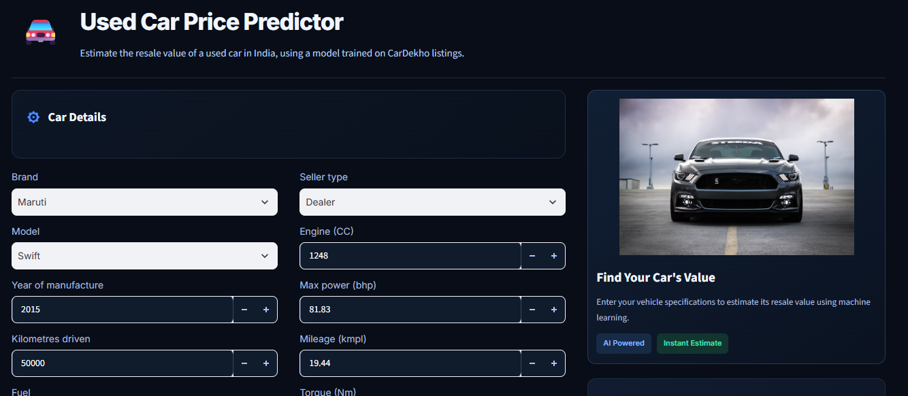
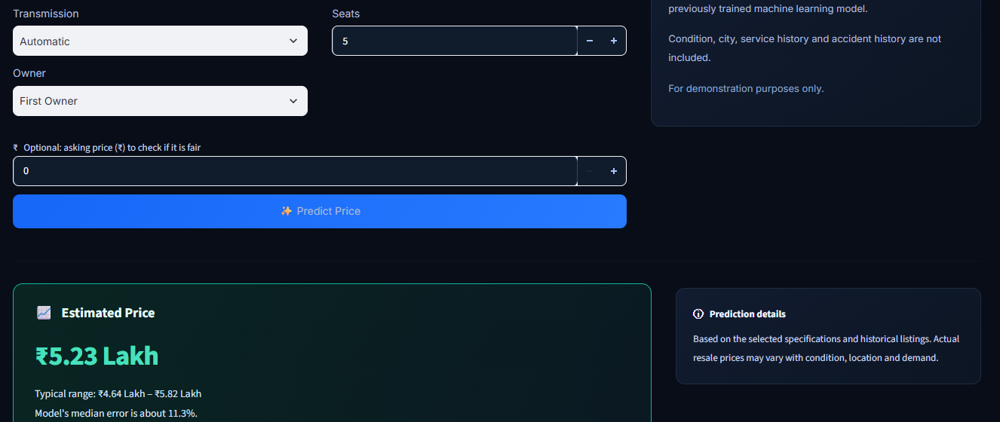

# 🚗 Used Car Price Predictor

Predicts the resale price of a used car in India from its specs, and compares an asking price with the estimate.

<<<<<<< HEAD
**🔗 Live demo:** [Try the app]([YOUR_STREAMLIT_APP_URL]))
=======
**🔗 Live demo:** [Try the app](https://used-car-price-predictor-dt4tgazpbcqcvelwx2dqpa.streamlit.app/)
>>>>>>> c56527c (Update README with project and profile links)





## Results

- **R² ≈ 0.90** and a **median error of about 11–12%** on a held-out test set of 1,384 cars (MAE ≈ ₹70,000).
-Random Forest and XGBoost were tuned using 20 randomized-search trials each and achieved similar performance..
- Both clearly beat a Ridge baseline (R² 0.84), mostly on expensive cars.

| Model | MAE (₹) | RMSE (₹) | R² | Median error |
|---|---:|---:|---:|---:|
| Ridge (baseline) | 79,158 | 183,919 | 0.839 | 12.2% |
| Random Forest (tuned) | 70,593 | 145,483 | 0.899 | 11.4% |
| XGBoost (tuned) | 71,605 | 144,746 | 0.900 | 11.8% |

Selected model: XGBoost.

Random Forest achieved a lower MAE, while XGBoost achieved a slightly higher R² and lower RMSE in the reported comparison. XGBoost was selected for deployment.

## Data and approach

- **Dataset: Kaggle's Vehicle Dataset by Nehal Birla, based on CarDekho listings. Source file: Car details v3.csv.

- **Data cleaning: Removed 1,202 duplicate records before the train/test split, parsed vehicle specifications such as mileage and engine capacity, converted torque from kgm to Nm, excluded "Test Drive Car" owner entries, and removed odometer readings of 500,000 km or more.

- **Feature engineering: Created car age and extracted brand and car model information alongside numerical and categorical vehicle specifications.

- **Preprocessing: Used a scikit-learn pipeline with imputation, scaling, and one-hot encoding. Brands and models with fewer than 10 listings were grouped together.

- **Target transformation: Applied log1p(selling_price) to reduce the effect of right-skewed prices and converted predictions back to rupees.

## Key findings

- **Depreciation:** median price falls about 6.1% per year between ages 1 and 8 (₹6.0 lakh to ₹3.87 lakh).
- **Transmission:** automatic cars have a median price about 2.2× that of manual cars; diesel about 1.7× petrol. These gaps partly reflect car size and age, not just the feature.
- **Price drivers:** car age (correlation -0.72 with log price) and max power (0.65) are the strongest signals. In the model, age, power and torque have the highest permutation importance.
- **Weak spots:** highest error on Chevrolet (22.6% median), Tata (15.6%) and Toyota (14.0%).

## Limitations

- Data is from around 2020, and car age is measured against 2021.
- No information on condition, accident history, city or trim.
- Less reliable for rare or luxury models with few examples.
- The app's price range is a heuristic (prediction ± median error), not a calibrated prediction interval.

## Run locally

```bash
git clone YOUR_REPOSITORY_URL
cd used-car-price
python -m venv venv
venv\Scripts\activate        # Mac/Linux: source venv/bin/activate
pip install -r requirements.txt

# Download "Car details v3.csv" from Kaggle into data/
python src/clean.py
python src/train.py
streamlit run app/app.py
```

## Project structure

```text
data/            raw and cleaned CSVs (not committed)
notebooks/       EDA and insights notebooks
src/             clean.py, train.py
experiments/     model comparison, tuning and cross-validation scripts
app/app.py       Streamlit app
models/          saved model and metadata
reports/         charts and result tables
```

**Tech stack:** Python, pandas, NumPy, scikit-learn, XGBoost, matplotlib, seaborn, Streamlit.

## Author
Abhinaya K · [LinkedIn](https://linkedin.com/in/abhinaya-k-) · [GitHub](https://github.com/Abhinayakottayi)
